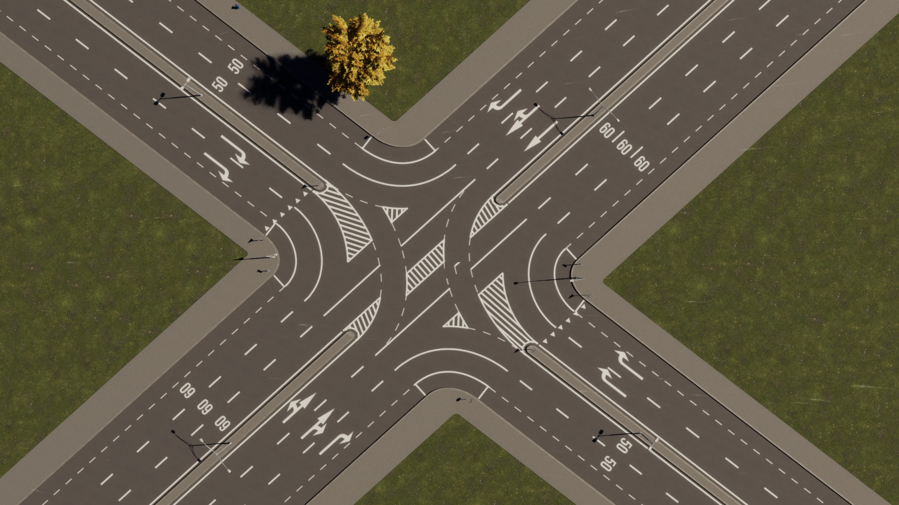
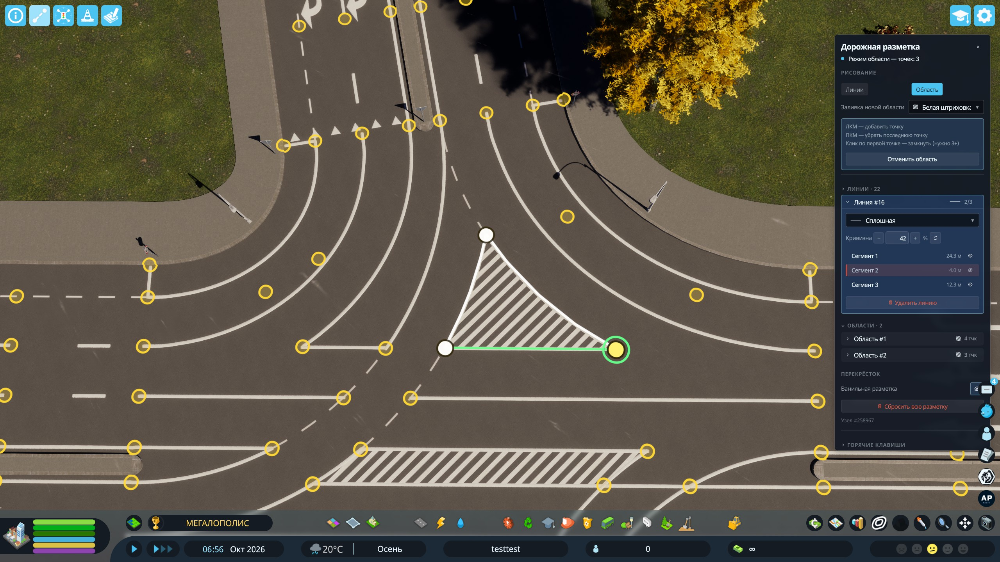
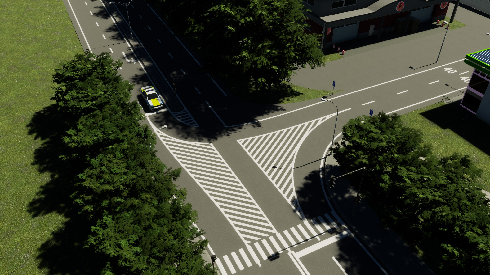
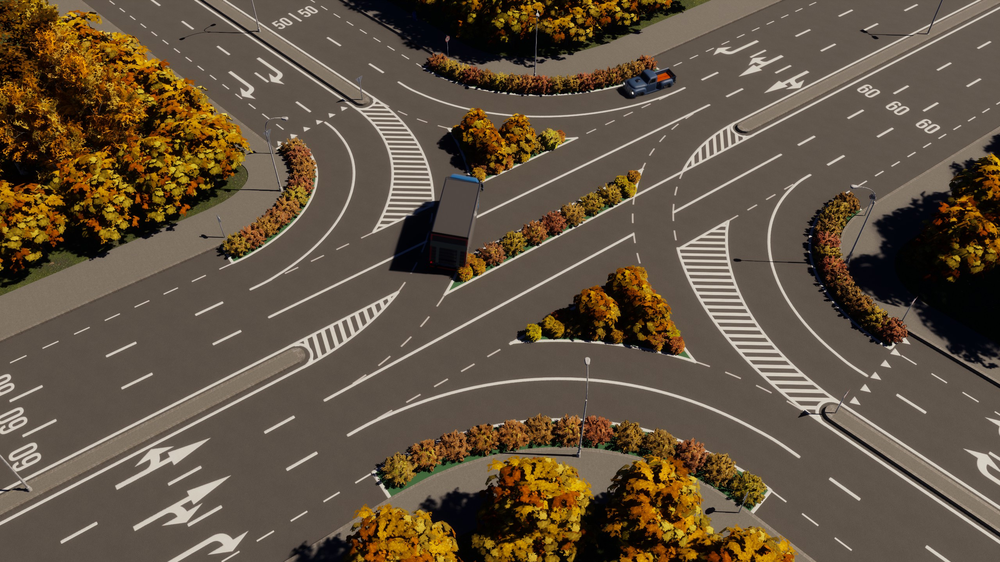
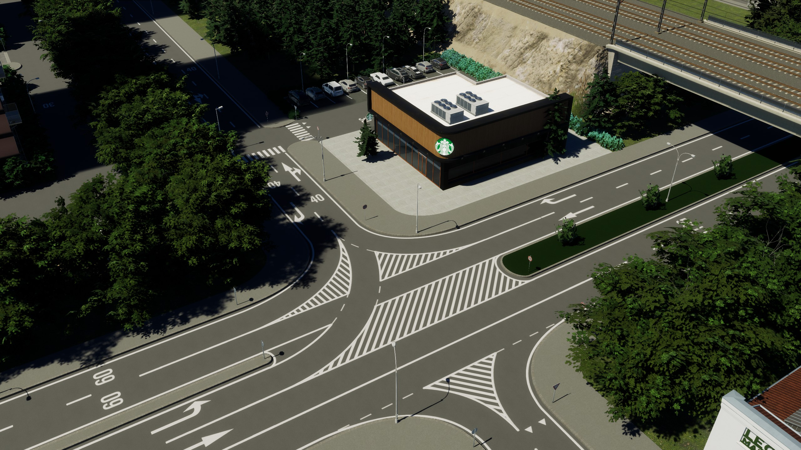
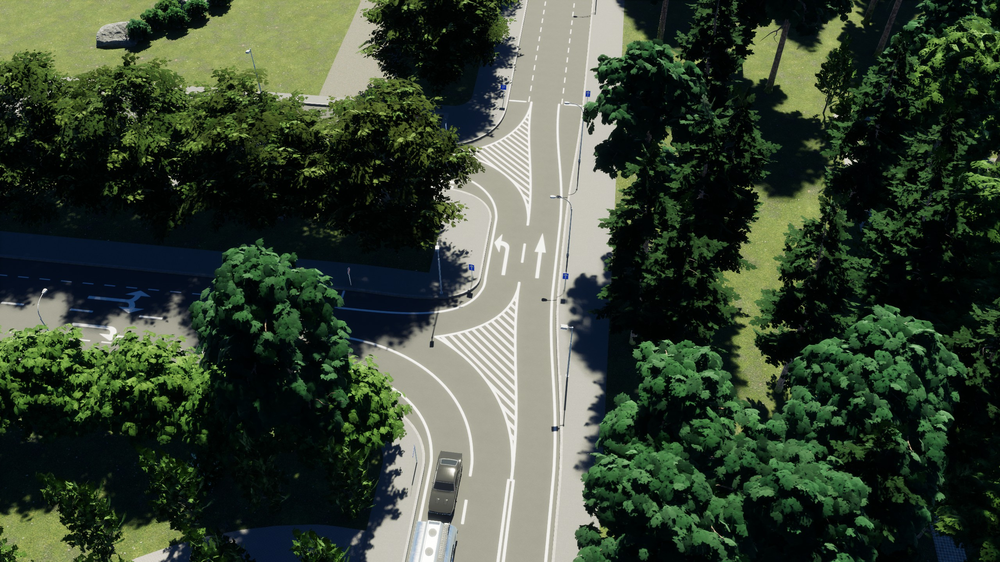
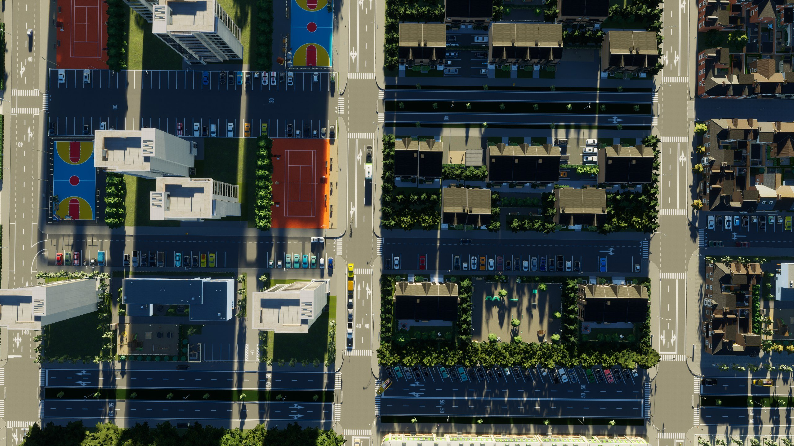

# Intersection & Lane Markings

A road-marking mod for **Cities: Skylines II**: a manual marking editor for intersections plus automatic edge/parking lane markings for ordinary town roads.



## Features

### Marking editor
Click any intersection — or the middle of a road — and draw your own markings:

- **Lines** between anchor dots — solid, dashed (short / normal / long), double solid, a vanilla yellow set (solid / dashed / double / solid + dashed), G87 white or yellow styles, and a curb line, with adjustable curvature and per-segment visibility.
- **Edit mode with curve handles** — switch the panel to **Edit**, click a line and drag its two blue handles on the road to shape the curve, Move It-style. Free points can be dragged there too, and **Add point** splits a line in the middle with a new point you can drag. Edit mode shows only what can be edited (lines, handles and free points), never the anchor dots, and draws nothing new. Each tab edits only its own kind — lines on the Lines tab, areas on the Areas tab — and a click takes exactly what is highlighted under the cursor, so nothing else gets grabbed by mistake.
- **Anchor dots everywhere you need them** — on every lane boundary, on the carriageway edge (including past parking lanes), and in a "setback" row 8 m before the junction, so you can draw the solid no-lane-change stretch in front of the stop line. Optional extras (on by default, in Options): a dot in the **centre of every lane** for arrows and centred lines, and **extra setback rows at 4 m and 16 m**.
- **Free draw** — switch it on (`F` or the panel) and click anywhere on the junction or its roads to place your own points and draw through them. Right-click a free point to remove it; move it in Edit mode.
- **Mid-road editing** — click the middle of a road to draw lines, areas and free points along it, with rows of anchor dots every 10 m.
- **Area fills** drawn like lines — click anywhere on the road to place corners (near a dot, kerb corner or line crossing they snap to it; snap targets only show up near the cursor), then click the first corner to close. In **Edit** mode click an area to open it: drag its corners, curve any side with its two blue handles, use the green **+** in the middle of a side to add a corner, and right-click a corner to remove it. Fills: junction box (yellow box), white/yellow hatching, green bike lane, red bus lane, concrete, grass, sand, pavement, tiles, asphalt patch. Area drawing stays on after you close an area, so you can outline the next one straight away.
- **Removing points** — right-click a white free point in any mode; its lines go with it, areas only lose that corner.
- **Points tab** — every free point you placed, with how many lines and areas use it. Hover a row to ring the point on the road, drag points there without touching lines or areas, and remove points one by one or all unused ones at once.
- **Snapping** like the game's own snap options — a snap bar with **All**, **existing geometry** (dots, kerb corners, line crossings, your lines), **90°** (along or across the road, or square to the previous segment), **road side** (the kerb), **guide lines** (lane lines continued straight, and lines along and across the road through your points) and **length** (0.5 m steps). Each one turns on and off on its own; where two cross, the point snaps to the crossing. Works in free draw, area drawing and when dragging points, corners and handles.
- **Hide vanilla markings** per intersection to start from a clean slate.
- **Pin favourite styles** — star any entry in a style dropdown to keep it at the top of every list.
- **Wide lines** (30 cm and 60 cm) as line styles, for stop lines.
- **Undo / redo** — `Ctrl+Z` / `Ctrl+Y` or the panel buttons, per junction or road, for every edit (tool and panel).
- **Move It support** — lines, line crossings and area fills follow a road that is moved or reshaped with Move It or the road tools.
- **Copy / paste and templates** — copy a junction's markings and paste them on another junction with the same number of roads; they are turned to fit, and **Turn** rotates them one road further. Save markings as named templates, kept between games (in `ModsData/ILM/templates.txt`).
- **Auto markings (test)** — guide lines along the lanes the game built through a junction, so they follow the Traffic mod's lane connections. Turn them on everywhere or per junction (a junction set to On or Off keeps its setting), choose the style and turning lanes only or all lanes. They are redrawn when the lanes change, leave the game's markings in place, and can be kept as normal lines.
- **Live editing** — dragging a handle, point or area corner moves the real marking as you drag, not just the outline.
- **In-game panel** in the game's own style: the tabs (**Lines**, **Areas**, **Points**) pick what you work on; below them, option rows like the game's tool options (**Mode** Draw / Edit, **Place on** Dots / Anywhere, **Style** or **Fill**, **Snapping**), a help card with the next step and the mouse controls, and the list. A fourth tab, **Advanced**, holds copy / paste, templates, auto markings and the junction settings; undo / redo sit in the footer. Hotkeys: `Ctrl+M` toggle tool, `Y` cycle line style, `A` area mode, `U` cycle area fill, `F` draw anywhere, `Ctrl+Z` / `Ctrl+Y` undo / redo.









### Automatic markings
Ordinary city roads with 3 m lanes get proper edge lane markings — the same way highways do — so parking, sidewalks and stops react correctly. Parking lane markings included. In North American-theme cities, one-way and divided roads (highways included) also get the US-style yellow line along the left, median-side edge — optional, on by default; European themes are unaffected.





## Known limitations

- **The mod is purely visual.** Markings never affect how vehicles actually drive. To change real lane behavior use [Traffic](https://github.com/krzychu124/Traffic) — set up lane connections and directions there first, then draw your markings to match. The two mods don't sync automatically.
- **Markings snap to anchor dots by default.** The dots sit on real road geometry (lane boundaries, lane centres, carriageway edges, kerb corners, line crossings, plus the setback rows before the junction), which is why markings land exactly on the lanes in a few clicks. Free draw places points anywhere on the junction and its roads, but not off the road surface — for markings elsewhere place the G87 packs' decals and net-lanes by hand.
- **Lines on optional dots** (lane centres, 4 m / 16 m rows) stay saved but are not drawn while that option is off.
- **Nearly-tangent line contacts** (well under ~8°) are treated as a graze rather than a crossing — no anchor dot appears at such touch points (by design; prevents jittery duplicate anchors).
- **Stretched junction connections** — highway ramps/merges and other junctions where the road/junction boundary is not perpendicular to the road — can misplace the anchor dots relative to the painted lines: the paint ends square to each lane, while the dots sit on the skewed boundary. Fix: normalize the junction with the **Node Controller** mod so the connection cross-lines run perpendicular to the road (strongly recommended). The setback dot row 8 m before the junction also stays usable.
- **Area fill edges** follow a line automatically only when that line was drawn with this mod. The game's own markings are not traced — along them the edge stays straight until you curve it with its handles in Edit mode.

## How it works

- **The mod replaces the game's lane-marking generator.** The vanilla `SecondaryLaneSystem` — the system that paints lane lines and parking markings along roads — is switched off, and a copy of it runs in its place with the mod's additions: automatic edge lines, the US yellow left edge line and per-junction hiding of vanilla markings. Traffic is unaffected: vehicles drive on the game's primary lanes, which the mod does not touch.
- **Compatibility.** Because of that replacement, a mod that patches or replaces the same vanilla system conflicts with this one. Mods that add markings as their own decals or net-lanes, such as the G87 packs, are not affected.
- **Game updates.** After every game update the copy is compared with the new vanilla system before the next release. Update 1.6.2 required no changes.
- **Log.** A few dozen lines per session in `Logs/ILM.Mod.log` — attach it to bug reports. For a step-by-step log of what the tool and panel do, add `"VerboseLogging": true` to `ILM.coc` (next to the `Logs` folder) and restart the game.
- **Development.** AI tools (Claude) are among the tools used to develop the mod. Every release is built from this repository and tested in-game on a real save before it is published; the full source is here — issues and code review are welcome.

## Dependencies

Line styles, area fills and the curb texture come from the G87 packs (installed automatically as PDX Mods dependencies):

- [G87] Road Markings (id 97828)
- [G87] Road Markings: Stripes and Chevrons (id 98624)
- [G87] Vanilla Curb (id 99062)

Optional: the **Asphalt patch** area fill uses the separate "G87 Vanilla Asphalt Pavement" mod — without it that fill falls back to concrete.

## Building

Requires the official CS2 modding toolchain (`CSII_TOOLPATH` set up by the game's mod project wizard) and Node.js for the UI bundle.

```powershell
cd src/ILMUI
npm install          # once
cd ..
dotnet build src/ILM/ILM.csproj
```

The build compiles the C# systems, bundles the React UI via webpack, and deploys everything to the local `Mods/ILM` folder.

## Project layout

- `src/ILM/` — C# mod:
  - `Components/` — saved marking data (lines, segments, areas, per-node overrides);
  - `Geometry/` — curve building, intersections, polygon splitting;
  - `Systems/Topology/` — how lines split at crossings and area outlines, rebuilt when lines or areas change;
  - `Systems/Emission/` — turns marking data into game lanes and area fills, incl. the replacement lane generator;
  - `Systems/Prefabs/` — marking and surface prefabs cloned from vanilla and G87 packs;
  - `Systems/Tool/`, `Systems/UI/` — the in-game tool, its overlay and the panel bindings;
  - `Diagnostics/` — developer-only dumps, Debug builds only.
- `src/ILMUI/` — React (cohtml) UI: tool panel, toolbar button, localization.

## Credits

- **Town Road Lane** by **mxerf** — ILM is a modified fork of [Town Road Lane](https://github.com/mxerf/town-road-lane) (GPL-3.0).
- **G87** — the marking prefab packs this mod builds its styles on.
- **TrafficToolEssentials** (ZessonsDE) — the UI build pipeline and several cohtml UI patterns are modelled on it.

## License

[GPL-3.0](LICENSE)
