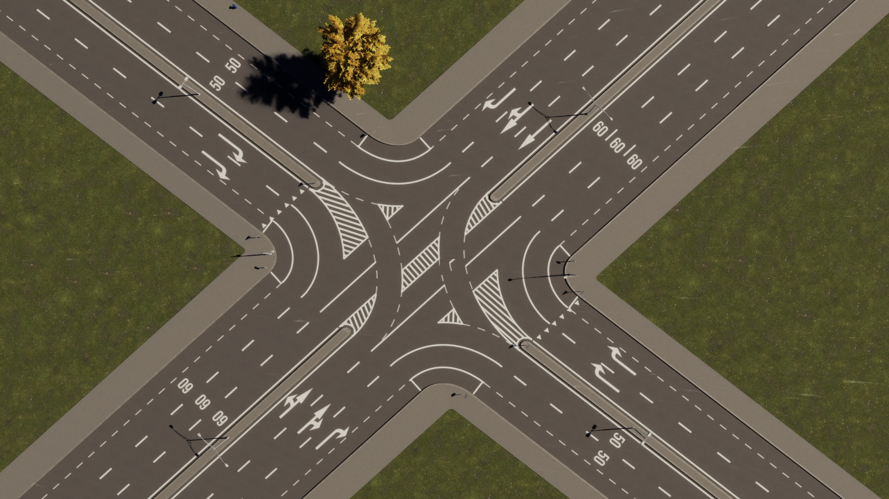
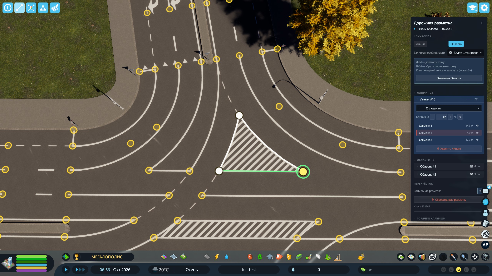
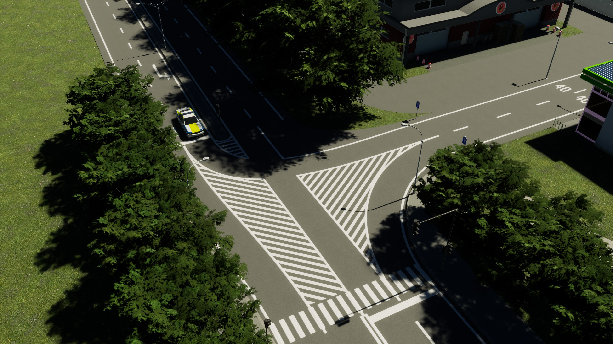
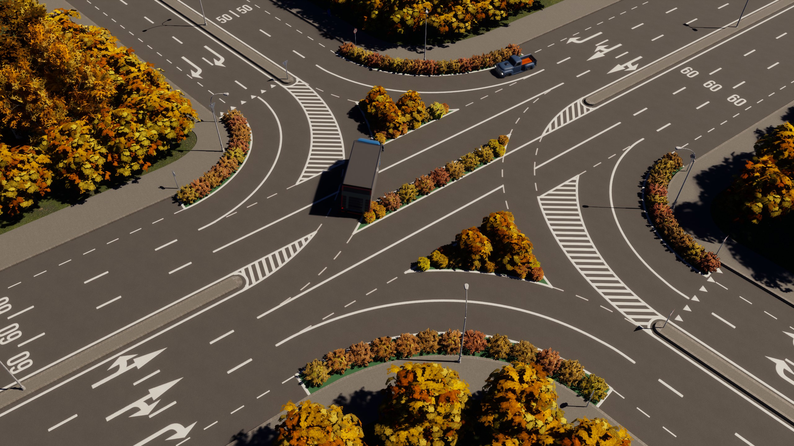
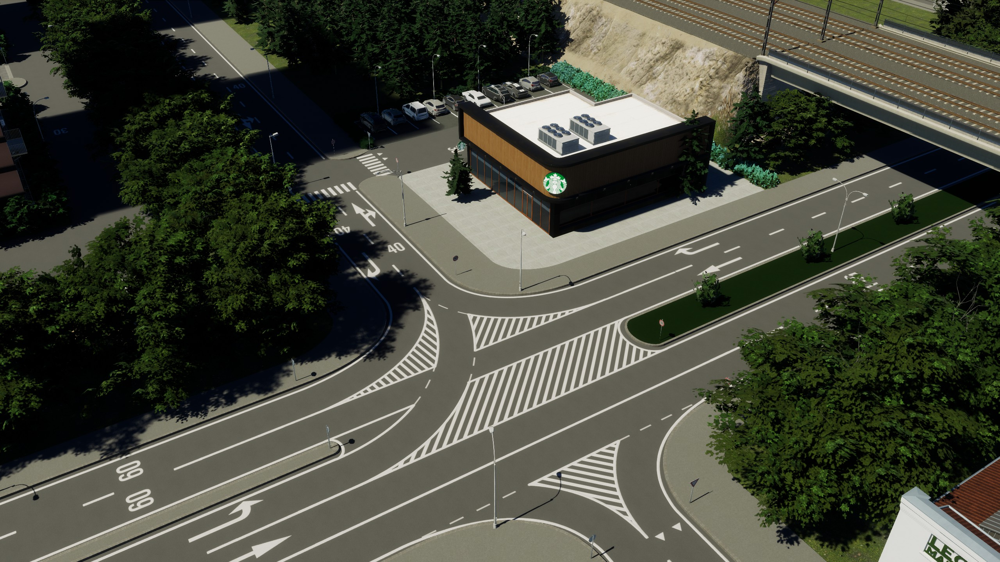
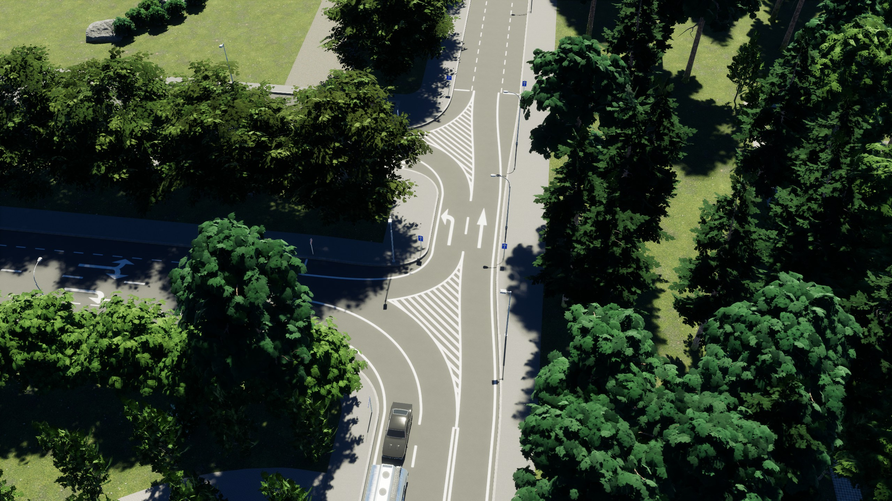
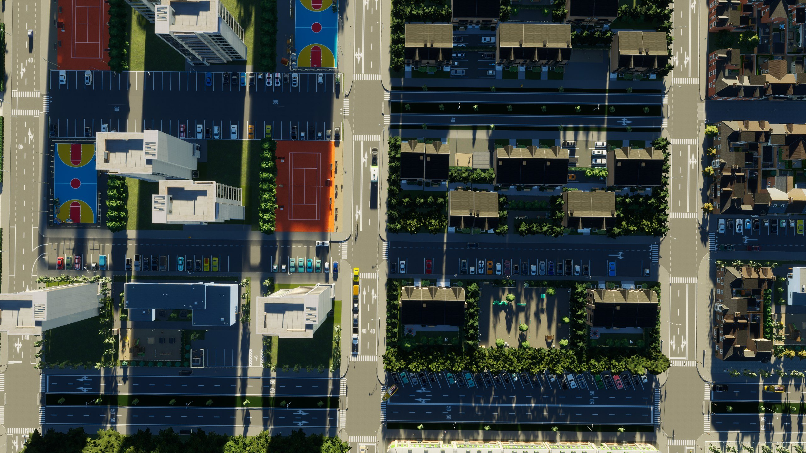

# Intersection & Lane Markings — дорожная разметка

[English](README.md) | **Русский**

Мод дорожной разметки для **Cities: Skylines II**: ручной редактор разметки перекрёстков плюс автоматическая краевая и парковочная разметка обычных городских дорог.



## Возможности

### Редактор разметки
Кликните по любому перекрёстку — или по середине дороги — и нарисуйте свою разметку:

- **Линии** между точками-якорями — сплошная, пунктир (короткий / обычный / длинный), двойная сплошная, ванильный жёлтый набор (сплошная / пунктир / двойная / сплошная + пунктир), белые и жёлтые стили G87, бордюр; настраиваемая кривизна и видимость отдельных сегментов.
- **Режим правки с ручками кривой** — переключите панель в **«Правка»**, кликните линию и тяните две голубые ручки на дороге, чтобы изогнуть её, как в Move It. Там же перетаскиваются свободные точки, а **«Добавить точку»** делит линию посередине новой подвижной точкой. В режиме правки видно только то, что можно править (линии, ручки и свободные точки), точки-якоря скрыты и новые линии не рисуются.
- **Точки-якоря везде, где нужны** — на каждой границе полос, на краю проезжей части (в том числе за парковочными полосами) и рядом за 8 м до перекрёстка — для сплошной перед стоп-линией, запрещающей перестроение. Дополнительно (включено по умолчанию, в настройках): точка **по центру каждой полосы** — для стрелок и осевых линий — и **дополнительные ряды за 4 м и 16 м**.
- **Свободное рисование** — включите его (`F` или в панели) и кликайте в любом месте перекрёстка или его дорог, чтобы ставить свои точки и рисовать через них. Правый клик по точке удаляет её, перемещать её можно в режиме правки.
- **Разметка посреди дороги** — кликните по середине дороги, чтобы рисовать вдоль неё линии, области и свободные точки; ряды точек-якорей идут каждые 10 м.
- **Заливки областей** рисуются как линии — кликайте в любом месте дороги, чтобы ставить углы (рядом с точкой, углом бордюра или пересечением линий угол притягивается к ним; точки для притяжения видны только возле курсора), затем кликните первый угол, чтобы замкнуть. В режиме **«Правка»** кликните область: тяните её углы, изгибайте любую сторону двумя голубыми ручками, зелёный **+** посередине стороны добавляет угол, правый клик по углу удаляет его. Заливки: вафельная разметка, белая и жёлтая штриховка, зелёная велополоса, красная автобусная полоса, бетон, трава, песок, тротуарная плитка, плитка, асфальтовая заплатка. После замыкания области режим не выключается — можно сразу обводить следующую.
- **Удаление точек** — правый клик по белой свободной точке в любом режиме; её линии удаляются вместе с ней, а области лишь теряют этот угол.
- **Скрытие ванильной разметки** на отдельном перекрёстке, чтобы начать с чистого листа.
- **Пины любимых стилей** — звёздочка в любом дропдауне стилей закрепляет стиль наверху всех списков.
- **Панель в игре** в стиле самой игры (английский + русский): вкладки «Линии» / «Области» / «Ещё» и переключатель режима (по точкам / свободно / правка). Горячие клавиши: `Ctrl+M` — инструмент, `Y` — стиль линии, `A` — режим области, `U` — заливка области, `F` — свободное рисование.









### Автоматическая разметка
Обычные городские дороги с полосами 3 м получают краевую разметку — как на шоссе, — поэтому парковка, тротуары и остановки работают корректно. Разметка парковочных полос включена. В городах с североамериканской темой односторонние и разделённые дороги (включая шоссе) дополнительно получают жёлтую линию вдоль левого края, со стороны медианы, — по американской конвенции; опция включена по умолчанию, европейские темы не затрагиваются.





## Известные ограничения

- **Мод чисто визуальный.** Разметка не влияет на реальное движение машин. Управлять полосами нужно модом [Traffic](https://github.com/krzychu124/Traffic): сначала настройте там направления и соединения полос, затем нарисуйте разметку под них. Автоматической синхронизации между модами нет.
- **По умолчанию разметка цепляется к точкам-якорям.** Точки стоят на реальной геометрии дороги (границы и центры полос, край проезжей части, углы бордюров, пересечения линий, плюс ряды перед перекрёстком) — поэтому разметка ложится точно по полосам за несколько кликов. Свободное рисование ставит точки в любом месте перекрёстка и его дорог, но не за пределами дорожного полотна — там ставьте декали и нет-лейны паков G87 вручную.
- **Линии на дополнительных точках** (центры полос, ряды 4 м / 16 м) сохраняются, но не рисуются, пока соответствующая опция выключена.
- **Почти касательные контакты линий** (заметно меньше ~8°) считаются скольжением, а не пересечением — точка-якорь в таком месте не появляется (намеренно: защита от дрожащих дублей-якорей).
- **Вытянутые соединения** — съезды и слияния шоссе и другие узлы, где граница «дорога/перекрёсток» не перпендикулярна дороге, — могут смещать точки-якоря относительно краски: линии обрываются перпендикулярно своей полосе, а точки стоят на скошенной границе. Лечение: нормализуйте перекрёсток модом **Node Controller**, чтобы поперечные линии соединений стали перпендикулярны дороге (настоятельно рекомендуется). Второй ряд точек за 8 м до перекрёстка тоже остаётся пригодным.
- **Рёбра заливок** сами следуют за линией, только если линия нарисована этим модом. Ванильную разметку заливка не огибает — вдоль неё ребро остаётся прямым, пока вы не изогнёте его ручками в режиме «Правка».
- **Move It:** после перемещения или изменения дороги линии подстраиваются под новую геометрию, а заливки областей — не всегда: удалите их и нарисуйте заново.

## Как устроен мод

- **Мод заменяет игровой генератор разметки полос.** Ванильная система `SecondaryLaneSystem` — та, что рисует линии полос и разметку парковок вдоль дорог, — отключается, а вместо неё работает её копия с дополнениями мода: автоматическими краевыми линиями, жёлтой левой линией (США) и скрытием ванильной разметки на отдельных перекрёстках. На движение это не влияет: машины ездят по основным полосам игры, которые мод не трогает.
- **Совместимость.** Из-за этой замены мод конфликтует с модами, которые патчат или заменяют ту же ванильную систему. Моды, добавляющие разметку своими декалями или net-lane, например паки G87, это не затрагивает.
- **Обновления игры.** После каждого обновления игры копия сверяется с новой ванильной системой до выхода следующей версии мода. Обновление 1.6.2 правок не потребовало.
- **Лог.** Несколько десятков строк за сессию в `Logs/ILM.Mod.log` — приложите его к баг-репорту. Подробный лог действий инструмента и панели: добавьте `"VerboseLogging": true` в `ILM.coc` (рядом с папкой `Logs`) и перезапустите игру.
- **Разработка.** При разработке мода в том числе используются ИИ-инструменты (Claude). Каждая версия собирается из этого репозитория и перед публикацией проверяется в игре на реальном сейве; исходный код открыт здесь — issues и ревью кода приветствуются.

## Зависимости

Стили линий, заливки и текстура бордюра берутся из паков G87 (ставятся автоматически как зависимости PDX Mods):

- [G87] Road Markings (id 97828)
- [G87] Road Markings: Stripes and Chevrons (id 98624)
- [G87] Vanilla Curb (id 99062)

Опционально: заливка **«Асфальт»** использует отдельный мод «G87 Vanilla Asphalt Pavement» — без него она откатывается к бетону.

## Сборка

Нужны официальный тулчейн моддинга CS2 (`CSII_TOOLPATH` настраивается визардом мод-проекта игры) и Node.js для UI-бандла.

```powershell
cd src/ILMUI
npm install          # один раз
cd ..
dotnet build src/ILM/ILM.csproj
```

Сборка компилирует C#-системы, собирает React-UI через webpack и раскладывает всё в локальную папку `Mods/ILM`.

## Структура проекта

- `src/ILM/` — C#-мод:
  - `Components/` — сохраняемые данные разметки (линии, отрезки, заливки, настройки узла);
  - `Geometry/` — построение кривых, пересечения, разбиение многоугольников;
  - `Systems/Topology/` — разбиение линий на пересечениях и контуры заливок, пересчёт при изменении линий или заливок;
  - `Systems/Emission/` — превращение разметки в игровые полосы и заливки, включая замену ванильного генератора;
  - `Systems/Prefabs/` — префабы разметки и поверхностей, клонированные из ванильных и из паков G87;
  - `Systems/Tool/`, `Systems/UI/` — игровой инструмент, его оверлей и привязки панели;
  - `Diagnostics/` — отладочные дампы, только в Debug-сборке.
- `src/ILMUI/` — React (cohtml) UI: панель инструмента, кнопка тулбара, локализация.

## Благодарности

- **Town Road Lane** от **mxerf** — ILM является изменённым форком [Town Road Lane](https://github.com/mxerf/town-road-lane) (GPL-3.0).
- **G87** — паки префабов разметки, на которых построены стили мода.
- **TrafficToolEssentials** (ZessonsDE) — по его образцу сделаны сборка UI и ряд приёмов для cohtml.

## Лицензия

[GPL-3.0](LICENSE)
